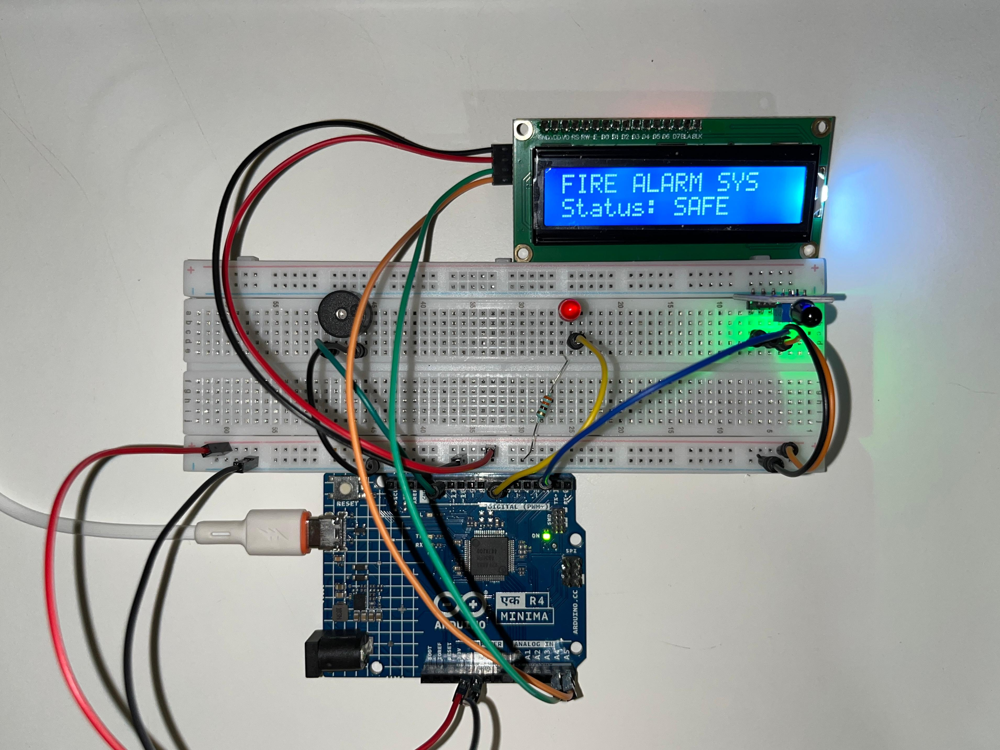

# Fire Alarm System

An Arduino project that detects a flame using a flame sensor and responds 
with an alarm: the buzzer sounds, the LED lights up, and the LCD changes 
from SAFE to a warning message.

## Components
- Arduino UNO R4 Minima
- 1x flame sensor module
- 1x 16x2 LCD display
- 1x LED + resistor
- 1x buzzer
- Breadboard + jumper wires

## How it works
The flame sensor picks up the infrared light a flame gives off and sends 
a signal to a digital input pin. The Arduino reads it with `digitalRead()`. 
While no flame is detected, the LCD shows "Status: SAFE". When a flame is 
detected, the Arduino turns on the LED and the buzzer and updates the LCD 
to show an alert.

## What I learned
This brings together skills from my earlier projects: LCD output from my 
counter and distance meter, and sensor input from my weather station and 
light sensor. The new part is triggering several outputs (LED, buzzer, 
and screen) from one sensor reading, which is the same pattern behind 
most alarm and monitoring systems.

## Note
This is a learning prototype and not a replacement for a real smoke or 
fire detector.
