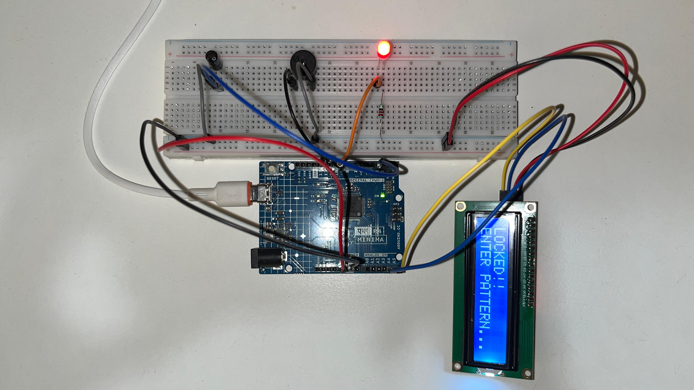

# Secret Knock Door Lock

An Arduino lock that opens to a secret knock pattern instead of a key. 
A piezo sensor listens for knocks. If the pattern matches the saved one, 
access is granted. Otherwise, access is denied.

## Components
- Arduino UNO R4 Minima
- 1x piezo sensor (knock detector)
- 1x 16x2 I2C LCD display
- 1x LED + resistor
- 1x Buzzer
- Breadboard + jumper wires

## How it works
The piezo turns the vibration of a knock into a small voltage. The Arduino 
reads it with `analogRead()` and counts a knock when the reading crosses 
a threshold. It measures the time between knocks with `millis()` and 
compares the rhythm to the saved pattern, allowing a small tolerance. 
The LCD shows LOCKED while waiting, then shows the result.

## What I learned
People never knock exactly the same way twice, so the hard part wasn't 
reading the sensor. It was deciding how close counts as "the same", and 
how to ignore the vibration that follows each knock.

## Note
This is a learning prototype, not a real security system. 
A pattern can be overheard and copied.

## Ideas for next time
- Record a new pattern using a button
- A servo to move a real latch
