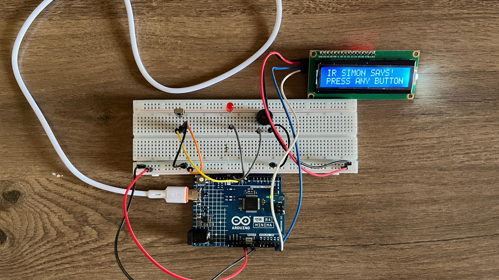

# IR Simon Says

A Simon Says memory game for Arduino, played with an infrared remote. 
The game shows a growing sequence of numbers and you repeat it with the 
remote's number buttons. Every correct round adds one more step.

## How the game plays
1. **IR SIMON SAYS! / PRESS ANY BUTTON**: press any button to start
2. **WATCH SEQUENCE**: the LCD shows each number in the sequence, 
   one at a time, while the LED flashes
3. **YOUR TURN!**: repeat the sequence on the remote; each press is shown 
   on the screen (**YOU PRESSED: 4**)
4. **CORRECT! LEVEL UP! +1**: the sequence grows by one step and the 
   next level begins

## Components
- Arduino UNO R4 Minima
- 1x IR receiver
- 1x IR remote (I used a phone with an IR remote app)
- 1x 16x2 I2C LCD display
- 1x LED + resistor
- 1x buzzer
- Breadboard + jumper wires

## Setup: use your own remote
Every remote sends different codes for its buttons, so the game can't 
assume one remote. The project has two sketches:

1. **`IR_Code_Reader`**: upload this first. Press each number button on 
   your remote and note the hex code the Serial Monitor prints.
2. **`IR_Simon_Says`**: put those hex codes into the `getButtonNum()` 
   function, which turns each code into a number. Then upload the game.

## How it works
Every button on an IR remote sends its own coded pulses of infrared 
light. The IR receiver picks them up, and the Arduino decodes them with 
the IRremote library. `getButtonNum()` turns each code into a number, 
and the game compares each press with the sequence it showed. The LCD, 
LED, and buzzer give feedback at each step.

## What I learned
My first project with wireless input. I had to decode a signal instead 
of reading a simple HIGH or LOW, and the code-reader sketch taught me to 
build a small tool first so the real program can work with any remote. 
The game itself is a loop of showing, listening, checking, and leveling 
up, with everything I'd built so far (LCD, LED, buzzer, input) working 
together.

## Ideas for next time
- Score and high score on the LCD
- Faster sequences at higher levels
